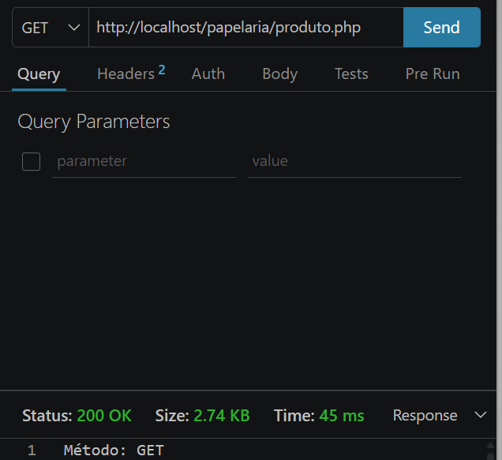
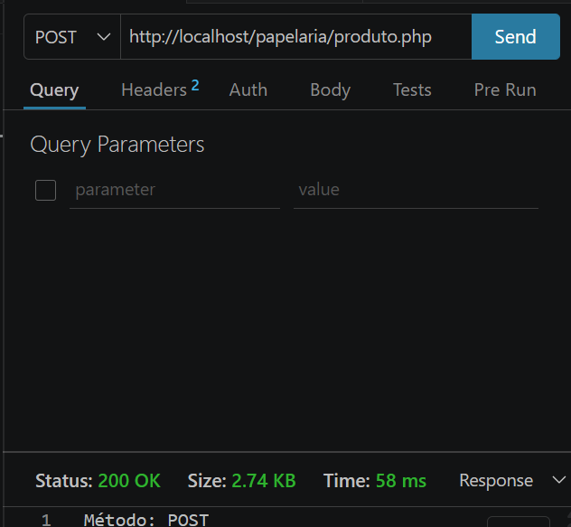
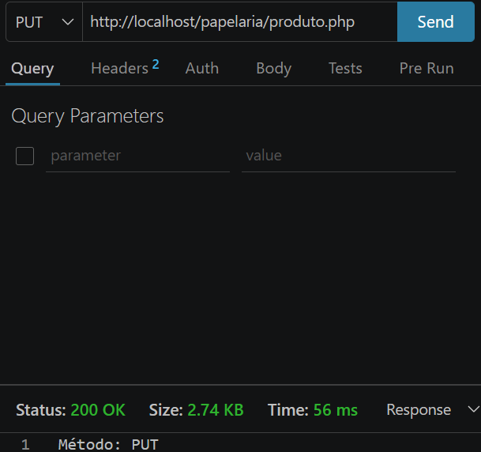
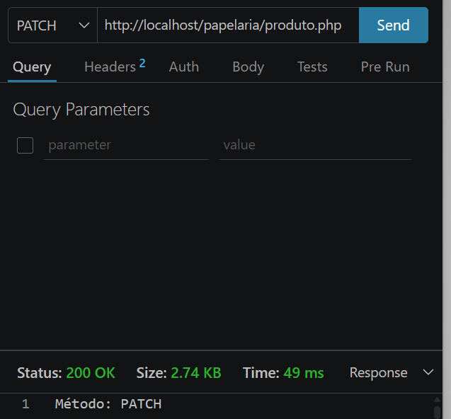
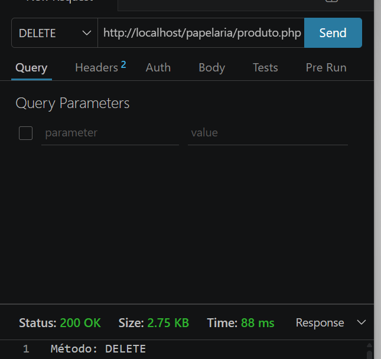
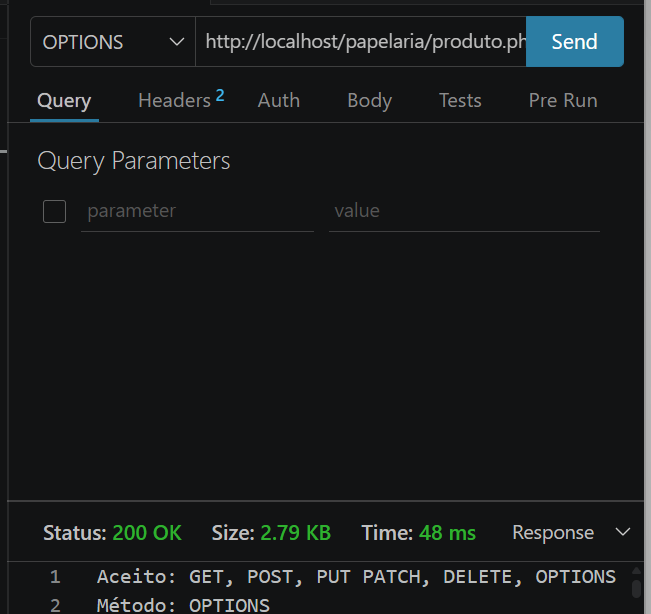

# 📒 API da Papelaria da Dona Lúcia

API em PHP + MySQL criada para a papelaria da Dona Lúcia, como atividade individual do SENAI. Hoje ela anota tudo no caderno; o app já está pronto e esta API é a parte do meio: recebe os pedidos do app e leva até o banco de dados.

De cada produto, a API guarda o **nome** e o **preço**.

## 🛠️ Tecnologias

- PHP (extensão `mysqli`)
- MySQL / MariaDB
- XAMPP (Apache + phpMyAdmin)
- Thunder Client (VS Code) para os testes

## 📁 Estrutura

```
papelaria/
├── banco.sql        # cria o banco, a tabela e cadastra os 5 produtos
├── produto.php      # a API
└── prints/          # prints dos testes no Thunder Client
```

## 🚀 Como rodar

1. Instale e abra o **XAMPP**, iniciando o **Apache** e o **MySQL**.
2. Copie a pasta `papelaria` para dentro de `htdocs` (ex.: `C:\xampp\htdocs\papelaria`).
3. Abra o **phpMyAdmin** (`http://localhost/phpmyadmin`) e execute o conteúdo de `banco.sql` na aba **SQL**.
4. No Thunder Client, envie as requisições para:

```
http://localhost/papelaria/produto.php
```

A conexão usa as credenciais padrão do XAMPP (`root` sem senha, em `localhost`).

## 🗄️ Banco de dados

Banco `papelaria`, tabela `produtos`:

| Coluna  | Tipo            | Observação                  |
|---------|-----------------|-----------------------------|
| `id`    | `INT`           | chave primária, auto incremento |
| `nome`  | `VARCHAR(255)`  | obrigatório                 |
| `preco` | `DECIMAL(10,2)` | obrigatório                 |

Estoque inicial da loja:

| id | Produto   | Preço     |
|----|-----------|-----------|
| 1  | Caderno   | R$ 15,90  |
| 2  | Lapiseira | R$ 8,50   |
| 3  | Borracha  | R$ 2,00   |
| 4  | Estojo    | R$ 12,00  |
| 5  | Cola      | R$ 6,90   |

## 🔌 Como a API funciona

Existe um único endpoint, `produto.php`. A API lê o método HTTP da requisição (`$_SERVER["REQUEST_METHOD"]`), executa o SQL do `if` correspondente e, no final, sempre devolve o método recebido e a lista atualizada de produtos.

| Método    | O que faz                          | Pedido da Dona Lúcia |
|-----------|------------------------------------|----------------------|
| `GET`     | Lista todos os produtos            | “Quero ver tudo o que tenho cadastrado.” |
| `POST`    | Cadastra um produto novo           | “Chegou caneta nova! Custa R$ 2,50.” |
| `PUT`     | Troca um produto inteiro (todos os campos) | “O caderno acabou. No lugar dele, agora vendo mochila, por R$ 89,90.” |
| `PATCH`   | Altera só um campo de um produto   | “Errei o preço da caneta: na verdade é R$ 3,00.” |
| `DELETE`  | Remove um produto                  | “Parei de vender borracha. Tira do sistema.” |
| `OPTIONS` | Informa quais métodos a API aceita | “O programador do app quer saber o que a sua API aceita.” |

### SQL de cada método

```sql
-- GET
SELECT * FROM produtos;

-- POST
INSERT INTO produtos (nome, preco) VALUES ('Caneta', 2.50);

-- PUT
UPDATE produtos SET nome = 'Mochila', preco = 89.90 WHERE id = 1;

-- PATCH
UPDATE produtos SET preco = 3.00 WHERE id = 6;

-- DELETE
DELETE FROM produtos WHERE id = 3;
```

O `OPTIONS` não mexe no banco: só responde a lista de métodos aceitos.

## 🧪 Testes

Os testes foram feitos no Thunder Client **nessa ordem**, porque cada um muda o banco para o próximo. Depois de cada envio, o resultado foi conferido no phpMyAdmin.

### 1. GET: ver tudo


### 2. POST: cadastrar a caneta


### 3. PUT: trocar o caderno pela mochila


### 4. PATCH: corrigir o preço da caneta


### 5. DELETE: tirar a borracha


### 6. OPTIONS: o que a API aceita


## ✅ Loja final

Depois de todos os pedidos, um `GET` deve devolver:

| id | Produto   | Preço     |
|----|-----------|-----------|
| 1  | Mochila   | R$ 89,90  |
| 2  | Lapiseira | R$ 8,50   |
| 4  | Estojo    | R$ 12,00  |
| 5  | Cola      | R$ 6,90   |
| 6  | Caneta    | R$ 3,00   |
